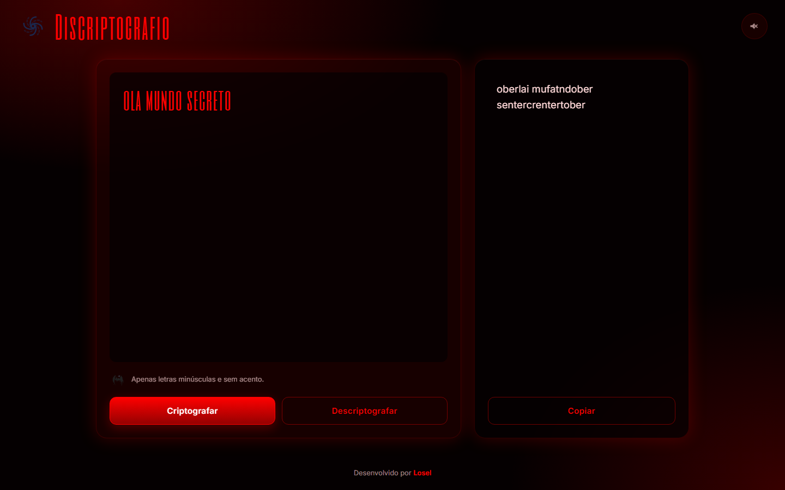

# Discriptografio

Site que criptografa e descriptografa mensagens por **embaralhamento de vogais**.

**Acesse:** [discriptografio.vercel.app](https://discriptografio.vercel.app/)



## Como funciona

Cada vogal é trocada por uma "chave":

| Letra | Chave   |
|:-----:|---------|
| `e`   | `enter` |
| `i`   | `imes`  |
| `a`   | `ai`    |
| `o`   | `ober`  |
| `u`   | `ufat`  |

Exemplo: `ola mundo secreto` → `oberlai mufatndober sentercrentertober`.

Antes da conversão, o texto é convertido para minúsculas e os acentos são removidos.

## Funcionalidades

- Criptografar e descriptografar com um clique
- Copiar o resultado para a área de transferência
- Feedback visual com toast e validação da entrada
- Som ambiente opcional (botão no cabeçalho)
- Layout responsivo (desktop, tablet e celular) e acessível (labels, foco visível, `prefers-reduced-motion`)

## Tecnologias

HTML, CSS (custom properties e grid) e JavaScript puro, sem dependências.

## Rodando localmente

```bash
git clone https://github.com/LoselSpt/Discriptografio.git
cd Discriptografio
# abra o index.html no navegador ou sirva a pasta:
npx serve .
```

---

Desenvolvido por [Losel](https://github.com/LoselSpt).
